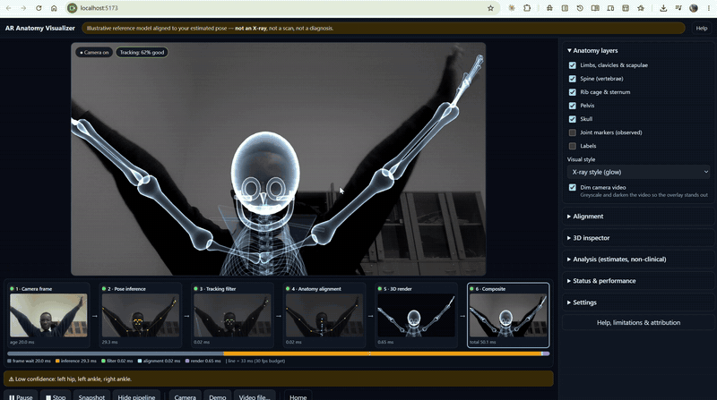

# AR Anatomy Visualizer — MVP

Browser-based, local-first AR anatomy visualiser. A webcam feed is processed **on the device** by MediaPipe Pose Landmarker, the landmarks are smoothed and confidence-gated, and a **generic 3D reference skeleton** (Three.js) is aligned to the estimated pose and overlaid on the video.

> **Not an X-ray, scan or diagnostic tool.** An RGB camera cannot see inside the body. The skeleton is an illustrative model positioned from estimated *external* landmarks. Angles are educational estimates, not clinical measurements.

## Demo

[](docs/media/demo.mp4)

▶ **[Watch the full demonstration (3 min 35 s, MP4, 12 MB)](docs/media/demo.mp4)**. It covers live webcam tracking, the six-stage pipeline view, the 3D inspector, the analysis panel and settings.

Implements *AR Anatomy Visualizer — PRD & System Architecture Specification v1.0 (11 Nov 2026)*; see the [traceability matrix](#requirements-traceability).

---

## Quick start (VS Code)

Requirements: **Node.js 20+** (22 LTS recommended), Chrome or Edge.

```bash
npm install            # also copies the MediaPipe WASM runtime into public/mediapipe/wasm
npm run fetch-models   # optional: download pose models into public/models (offline / self-hosted)
npm run dev            # http://localhost:5173
```

In VS Code: open the folder, accept the recommended extensions, then press **F5** ("Debug app in Chrome"). This starts the dev server and opens Chrome with breakpoints in the TypeScript sources.

Camera access needs a secure context: `http://localhost` works. On another device on your network you need HTTPS (e.g. deploy the `dist/` folder to any static HTTPS host).

| Script | Purpose |
| --- | --- |
| `npm run dev` | Dev server with hot reload |
| `npm run build` | Type-check + production build to `dist/` |
| `npm run preview` | Serve the production build on :4173 |
| `npm test` | Unit tests (Vitest): filter, tracker, rig mapping, measurements, demo generator |
| `npm run e2e` | Headless end-to-end smoke test (Playwright). Needs a build and, once, `npx playwright install chromium` |
| `npm run fetch-models` | Download `pose_landmarker_lite/full.task` (add `-- heavy` for heavy) |

## Using it

- **Start camera**: stand 2–3 m away, facing the camera, whole body in view, even lighting.
- **Demo mode**: a synthetic person performing arm raises, squats, a wave and a side-bend/march, with no camera needed. It also has adjustable landmark noise and simulated occlusion, which are useful for testing the tracker.
- **Video file…**: run the same pipeline on a recorded clip (local only), e.g. for a repeatable evaluation set.
- **Layers**: limbs/clavicles/scapulae, spine, rib cage, pelvis, skull, observed joint markers, labels; X-ray-style or solid.
- **Alignment**: scale, offset, rotation and opacity, plus reset.
- **3D inspector**: the same model in metric world space; orbit and zoom independently.
- **Analysis**: 8 joint angles (3D when world landmarks are available), posture tilts and L/R symmetry, each with confidence. Optional in-memory recording with CSV export.
- **Live pipeline** (toggle with `P`): six live previews show each processing stage as it happens: camera frame → pose inference (33 landmarks, confidence) → tracking filter (raw vs smoothed, held/lost) → anatomy alignment (observed vs inferred joints, spine curve, torso axes) → 3D render → composite. Each stage has a "just ran" pulse and its cost in ms. A waterfall bar compares the per-frame cost against the 33 ms budget. Click a stage (or press `1`–`6`) to inspect it full-size, and `Esc` to return.
- **Status**: render fps, inference rate/time, capture→overlay latency, tracking quality, landmark states, model/backend.
- **Settings**: mirror, smoothing (One Euro), confidence threshold, inference-rate cap, model lite/full/heavy, GPU/CPU, resolution, raw-landmark debug overlay.
- Keyboard: `Space` pause, `S` snapshot, `L` labels, `J` joints, `D` raw landmarks, `P` pipeline, `1`–`6` stage view, `Esc` composite.

## Stack

| Layer | Technology |
| --- | --- |
| UI | React 19 + TypeScript 5.9, built with Vite 8 |
| Camera | Browser `getUserMedia` + `requestVideoFrameCallback` |
| Pose estimation | MediaPipe Tasks Vision (Pose Landmarker lite/full/heavy), running as WASM with a WebGL GPU delegate in the browser |
| Filtering / alignment / measurements | TypeScript modules (One Euro filter, rig mapping, angle maths) |
| 3D rendering | Three.js (WebGL), CSS2D labels, OrbitControls |
| Tests | Vitest (unit), Playwright (end-to-end) |
| Backend | **None in the MVP**: the app is static files. Planned stack (spec §5, §7.2): **Python FastAPI + PostgreSQL in Docker**, only for accounts, saved session metadata and asset management. It never receives video. |

## Architecture

```
src/
├── app/         VisualizerEngine (pipeline orchestration), App shell, preferences, version/attribution
├── camera/      CameraService – getUserMedia lifecycle, error mapping, cancellation
├── vision/      MediaPipePoseEstimator, DemoPoseSource (synthetic) – both implement PoseEstimator
├── tracking/    OneEuroFilter, LandmarkTracker – confidence gating, hold-on-occlusion, outlier rejection
├── anatomy/     landmarks, rigMapping (landmarks → joints + torso/head frames + inferred spine),
│                measurements (angles, posture, symmetry), blend (render-rate interpolation)
├── rendering/   SkeletonModel (procedural bones), OverlayRenderer (ortho, camera-aligned),
│                InspectorView (perspective + orbit), materials, canvas2d (debug + demo silhouette),
│                pipelineStages (live per-stage visualisation)
├── components/  React UI: Home, LiveView, AnalysisPanel, StatusPanel, HelpDialog, controls
├── types/       Shared types + PipelineError
└── tests/       Vitest unit tests
scripts/         copy-mediapipe-wasm, fetch-models, e2e-smoke
docs/            asset licences, test plan, models (MODELS.md)
server/          placeholder – no backend in the MVP (spec §7.2)
```

Data flow per frame (§6.1): `requestVideoFrameCallback` marks a new frame → the estimator runs if the inference-rate budget allows (stale frames are dropped, never queued) → the `LandmarkTracker` gates and smooths → `buildAnatomyPose` produces image-space and world-space poses → the renderer interpolates toward them at display rate → overlay, inspector, debug layer, stats.

**Observed vs inferred** (Appendix B): every joint carries `observed`. Limb bones span observed landmarks. Spine, sternum, rib cage, pelvis and skull are placed from torso/head frames and generic proportions, so they are illustrative. Bones whose landmarks are briefly occluded are drawn dimmed; lost bones are hidden, never extrapolated. If the torso is lost, the whole model is hidden.

### Privacy & security

- Frames never leave the browser; nothing is recorded unless the user presses Snapshot or Record.
- **Content-Security-Policy** (injected by `vite.config.ts`) only allows connections to the page's own origin and `storage.googleapis.com` (model download). This also blocks the **usage-telemetry POST that the MediaPipe Tasks library sends to `odml.pa.googleapis.com`**: the library has no opt-out, and without the CSP it would breach AC-09. If you self-host the models (`npm run fetch-models`), you can remove `storage.googleapis.com` from `connect-src` for a fully same-origin app. If you deploy behind a server, prefer sending the same policy as an HTTP header.
- The camera is released on Stop, on leaving the view, on `pagehide`, and when a start is cancelled mid-permission-prompt. Hidden tabs pause inference.
- Only display preferences are stored (localStorage); "Clear local data" removes them.

## Verified in development

- Unit tests: 14 passing.
- E2E (headless Chromium, production build): 17 checks passing, including the live pipeline strip and full-size stage views. Covered: the limitation notice; demo overlay rendering; labels; alignment reset; snapshot; CSV export; keyboard pause; stop/clear; a fake-camera start with the real MediaPipe model; camera release; and no uploads or unexpected CSP violations.
- Real MediaPipe inference was checked on a public-domain photo fed through a fake camera. Landmarks and overlay aligned. That machine had no GPU, so inference took ~1 s per frame there. **Performance (NFR-01/02, AC-08) must be measured on your nominated reference laptop**; the Status panel shows the numbers live.

## Known limitations

- Single RGB camera: depth, left/right and overlapping limbs can be confused. Accuracy is best front-on and drops in side views, when twisting and when sitting.
- Proportions of the inferred axial skeleton are generic. The rib cage/pelvis are rigid parts and do not deform.
- The skeleton is a procedural, schematic model (no third-party asset). To use a licensed rigged GLB instead, add a new class implementing the same `update(pose: AnatomyPose | null)` contract as `SkeletonModel` and record its licence in `docs/ASSET_LICENCES.md`.
- One person at a time (`numPoses: 1`).
- Bone labels are not included in snapshots (they are HTML, not WebGL).
- Firefox/Safari are untested (NFR-03 targets Chrome/Edge first).

## Requirements traceability

| Req. | Where |
| --- | --- |
| FR-01 camera after user action + explanation | `Home.tsx`, `CameraService.start` |
| FR-02 camera selection | `LiveView` camera select, `CameraService.listCameras` |
| FR-03 live preview, start/pause/stop | `LiveView` toolbar, `VisualizerEngine.setPaused/stop` |
| FR-04 pose detection | `MediaPipePoseEstimator` |
| FR-05 confidence / unreliable warning | `LandmarkTracker` (quality, warnings), stage chip, Status panel |
| FR-06 smoothing | `OneEuroFilter`, `LandmarkTracker`, `blend.ts` |
| FR-07 reference anatomy, documented licence | `boneGeometry.ts` (procedural, MIT), `docs/ASSET_LICENCES.md` |
| FR-08 landmark→rig mapping | `rigMapping.ts` |
| FR-09 overlay rendering | `OverlayRenderer` |
| FR-10 scale/offset/rotation/opacity | Alignment panel → `OverlayRenderer.setAlignment` |
| FR-11 anatomy layers | `SkeletonModel` layers, Layers panel |
| FR-12 independent 3D inspection | `InspectorView` |
| FR-13 joint angles / symmetry | `measurements.ts`, `AnalysisPanel` |
| FR-14 snapshot on explicit action | `VisualizerEngine.snapshot` |
| FR-15 session history (Could) | in-memory angle recording + CSV export; server persistence deferred |
| FR-16 no-camera demo | `DemoPoseSource`, video-file mode |
| FR-17 error handling | `PipelineError` kinds, `ErrorBanner` recovery actions |
| FR-18 stop + clear | `stop()`, `clearSessionData()`, "Clear local data" |
| FR-19 keyboard & labels | native controls, `aria-*`, shortcuts, `:focus-visible` |
| FR-20 attribution | Help dialog, `version.ts`, `docs/ASSET_LICENCES.md` |
| NFR-05 recovery | disconnect handler, per-frame try/catch, WebGL context-loss, GPU→CPU fallback |
| NFR-06/07 privacy/security | local processing, CSP, no backend |
| NFR-08 modularity | interfaces `PoseEstimator`, engine/UI separation |
| NFR-10 observability | Status panel |
| NFR-11 not colour-only | text quality labels, solid vs wireframe joint markers, "low conf." text |
| AC-14 persistent notice | top bar in `App.tsx` |

## Licence

Project code (including the procedural skeleton): MIT. Third-party: MediaPipe Tasks Vision & Pose Landmarker models (Apache-2.0, Google), three.js (MIT), React (MIT).
